<p align="center">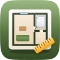</p>

<h1 align="center">Pocket Rooms</h1>

<p align="center">Plan your rooms to scale: draw your flat or house room by room — or start from a ready-made plan, a picture of a floor plan, or a Sweet Home 3D file — put in doors, windows and your own furniture by its real size, try different layouts side by side and in 3D, and let the plan check what you would only find out on moving day: a door that cannot open, no room to walk past the bed, a sofa that does not get round the corner.<br>One Go binary, one SQLite file, one volume. Part of the Pocket apps; works on its own too.</p>

<p align="center">
  <a href="https://github.com/abjelosevic88/pocket-homelab-rooms/actions/workflows/ci.yml"></a>
  <a href="https://github.com/abjelosevic88/pocket-homelab-rooms/pkgs/container/pocket-homelab-rooms"></a>
  <a href="LICENSE"></a>
</p>

<p align="center">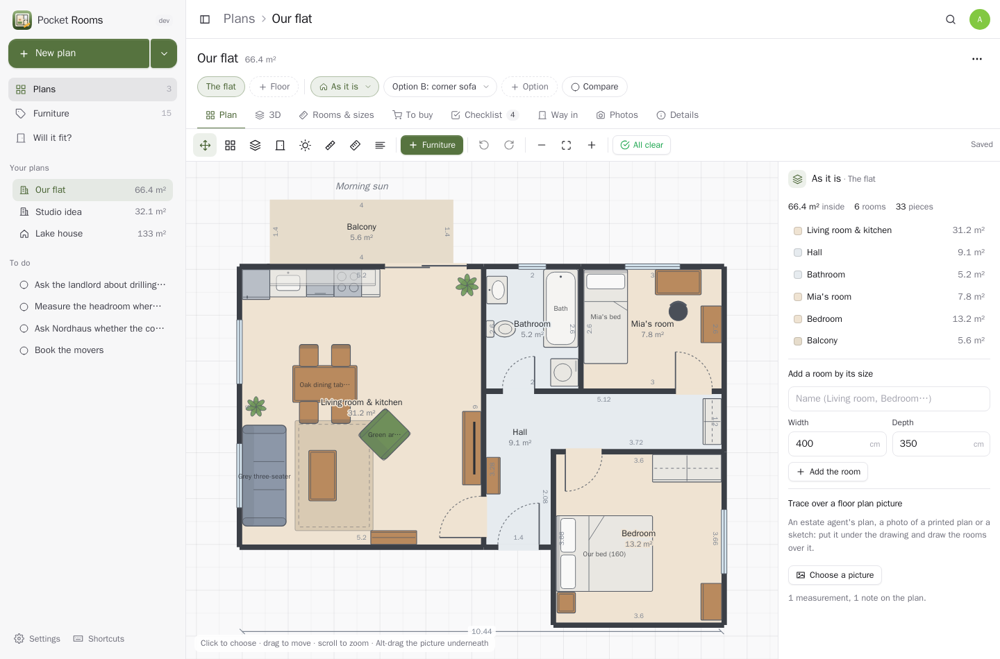</p>

<table>
  <tr>
    <td width="50%">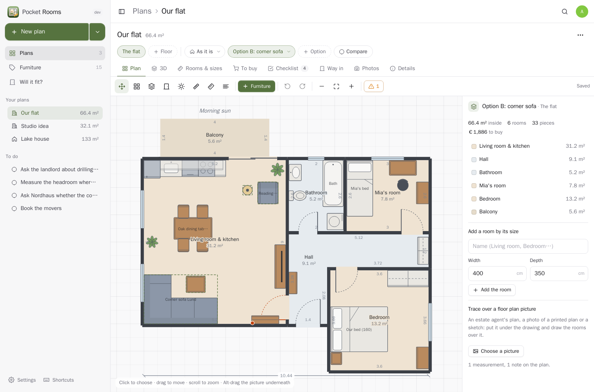</td>
    <td width="50%">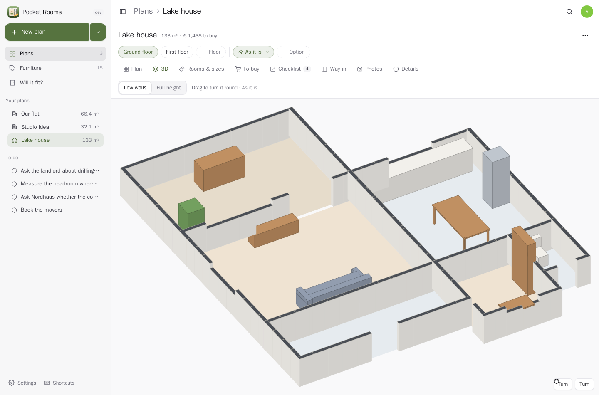</td>
  </tr>
  <tr>
    <td align="center"><sub>Options side by side: “Option B” tries a corner sofa — and the checks see the bookcase now blocks a door.</sub></td>
    <td align="center"><sub>Any layout in 3D, with low walls to look in; drag to turn it round.</sub></td>
  </tr>
  <tr>
    <td width="50%">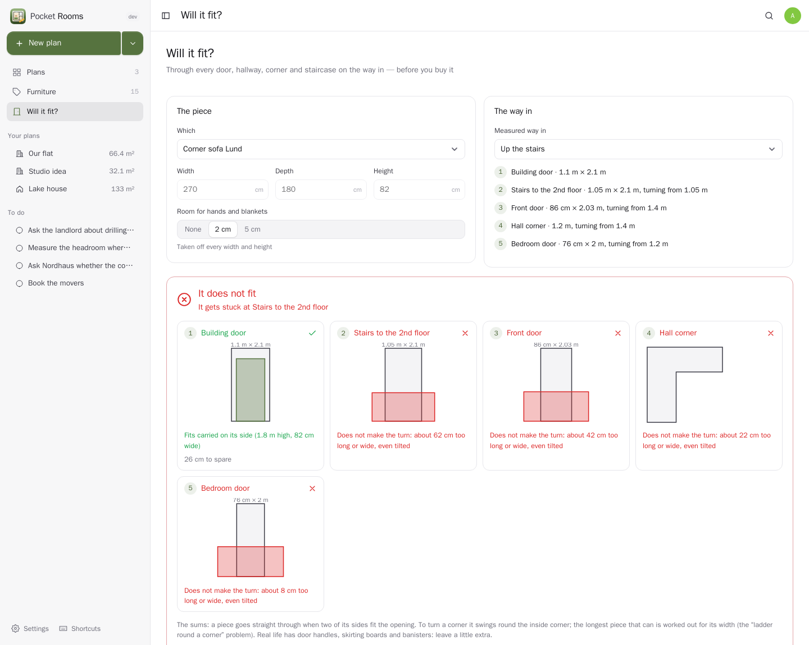</td>
    <td width="50%">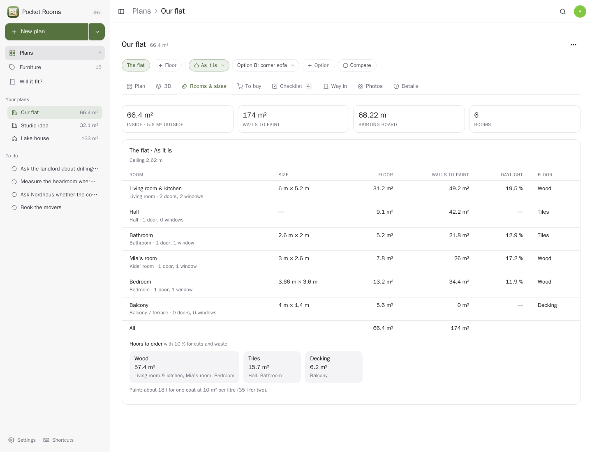</td>
  </tr>
  <tr>
    <td align="center"><sub>Will it fit? Every door, hallway, corner, staircase and lift on the way in, and how to carry it through.</sub></td>
    <td align="center"><sub>Rooms and sizes: areas, walls to paint, skirting, daylight, and the floor to order with 10 % for cuts.</sub></td>
  </tr>
  <tr>
    <td width="50%">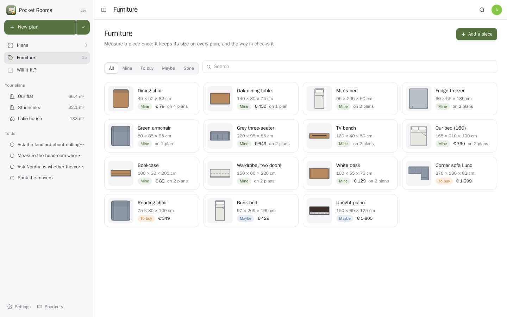</td>
    <td width="50%">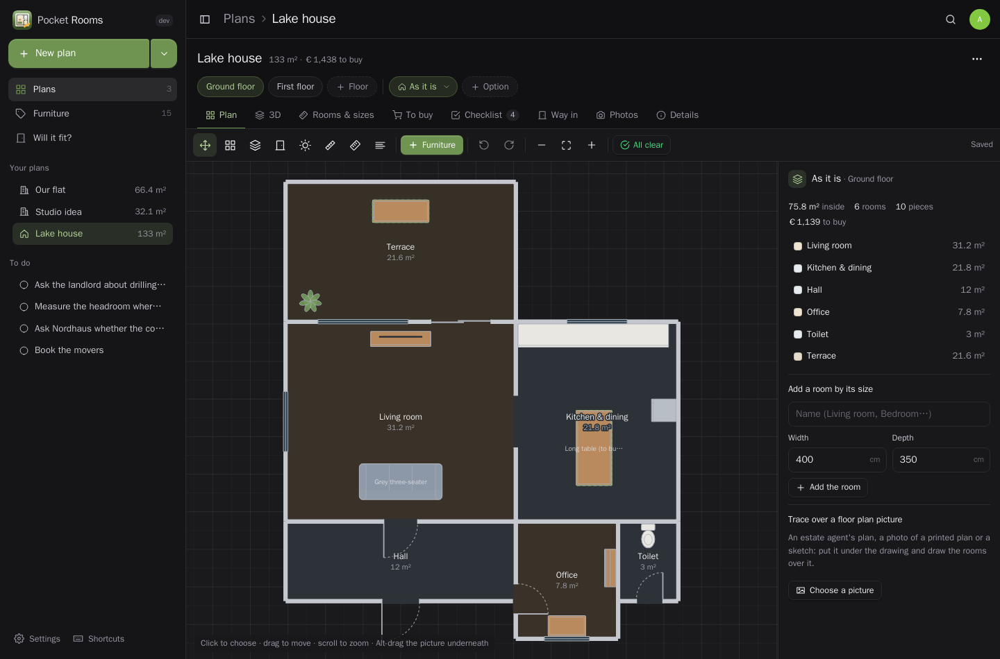</td>
  </tr>
  <tr>
    <td align="center"><sub>Your furniture, measured once: what you own and what you want, and where each piece stands.</sub></td>
    <td align="center"><sub>Light and dark follow your device.</sub></td>
  </tr>
</table>

<p align="center">
  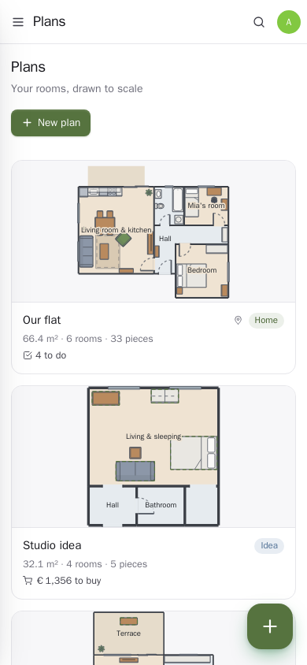
  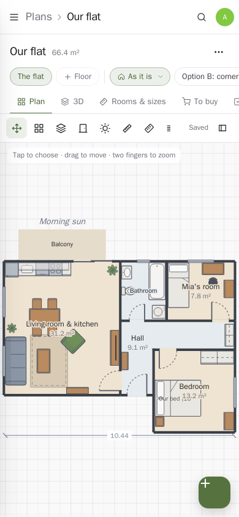
  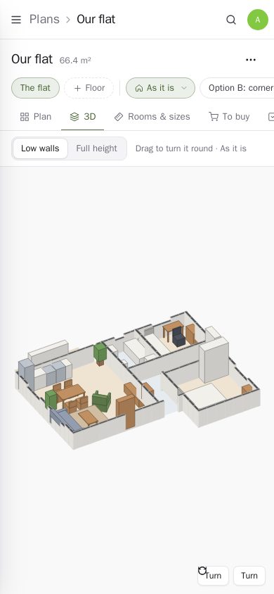
</p>

## What it does

- **Draw to scale.** Rectangle rooms by dragging (lengths show as you draw) or by typing their size, rooms of any shape corner by corner, walls on their own, doors (single, double, sliding, pocket, garage) and windows that snap to a wall and open the way you set. Drag a wall to resize a room, a corner to reshape it; double-click a wall to add a corner. Everything is centimetres underneath; type `2.4 m`, `240`, or `7' 10"` in feet and inches if you like.
- **Furniture by its real size.** A catalogue of 40 kinds with their usual sizes, drawn the way architects draw them; your own measured pieces keep their size on every plan (change it once, every copy follows). Pieces stick to walls as you move them, turn in 15° steps, resize from their corners; wall cupboards sit above the worktop.
- **Layouts.** Each floor has “As it is” and as many options as you like; **compare** two side by side with what moves, what is new and what it costs. Several floors per plan, each with its own ceiling height.
- **Checks while you draw**: pieces on top of each other or through a wall, doors that hit furniture when they open, and the room you need around things — 70 cm in front of a wardrobe, 60 cm beside a bed, a metre in front of the kitchen, room to pull a chair out.
- **Will it fit?** Measure the way in once — building door, stairs, lift, front door, the hall corner — and every piece is checked against it: carried upright, on its side or on its end, turned diagonally in a doorway, tilted up to get round a corner (the ladder-round-a-corner sums, for a piece with a width).
- **Rooms and sizes**: floor areas, walls to paint (doors and windows taken off), skirting board, daylight, and the floor to order per finish. **To buy**: every piece marked “still to buy”, with the budget.
- **Start from a picture**: Pocket AI reads the rooms and sizes from an estate agent's plan or a sketch and keeps the picture underneath to check against; or trace over any picture yourself after setting its scale. **Sweet Home 3D** files come in with rooms, walls, doors, windows and furniture.
- **3D** of any layout, a **view-only link** to send to family or the landlord, **print**, **PNG and SVG**. A **checklist** per plan with a reminder the day before something is due. Room **photos**.
- **Everyone their own** on one box. Plain language, phone first, light and dark.

## Run it

```sh
docker run -d --name pocket-rooms -p 8080:8080 -v ./data:/data \
  -e BASE_URL=https://rooms.example.com -e SECURE_COOKIES=true \
  ghcr.io/abjelosevic88/pocket-homelab-rooms:latest
```

or `docker compose up -d` with [docker-compose.yml](docker-compose.yml). Open it, create the first account and start a plan. All options: [docs/configuration.md](docs/configuration.md). API: [docs/api.md](docs/api.md). Backups: [docs/backup.md](docs/backup.md).

## With Pocket Core

Set `CORE_URL` and `CORE_REGISTRATION_KEY` and Rooms joins the box: people sign in with Pocket Core, Pocket AI helps, and through app links your plans reach your own Pocket apps with nothing to paste:

| App | In Rooms | Scopes |
|---|---|---|
| Pocket Home | tie a plan to a home; its appliances and house plants go on the plan by room | `home:read` |
| Pocket Inventory | furniture you already keep there, onto a plan or into your measured pieces | `items:read` |
| Pocket Wishlist | check a wish against your doors before you buy; put planned furniture on your wishlist, ticked off when bought | `wishes:read`, `wishes:write` |
| Pocket Tasks | a plan's checklist as tasks | `tasks:write` |
| Pocket Notes | the summary — rooms, areas, paint, floor, shopping list — as a note | `notes:write` |
| Pocket Files | a picture of a layout saved in your files | `files:write` |
| Pocket Photos | room photos on the plan; a floor plan picture to trace over | `photos:read` |
| Pocket Rentals | the plan of a flat you let, kept with its unit | `rentals:read` |
| Pocket Money | a bought piece booked as an expense | `accounts:read`, `transactions:write` |
| Pocket Chat | “which layout do you like?” — a layout card in the household chat | `chat:read`, `chat:write` |

**Nothing depends on another app.** Each app's state is checked per person, and what needs it is shown greyed out with one line saying why, never hidden.

Other apps use your plans through `rooms:read` and `rooms:write`: Pocket AI answers “how big is the bedroom?”, “what is still to buy?” and “does a 228 cm sofa get through my door?”; Pocket Search finds rooms, plans and furniture; Pocket Day shows checklist items. Events on the bus — `rooms.plan_created`, `rooms.layout_saved`, `rooms.piece_added`, `rooms.piece_bought`, `rooms.todo_done` — start flows in Pocket Flows. The AI (reading plans and sizes, tips for a layout) can also be your own OpenAI-compatible key.

## Develop

```sh
make dev     # API on :8080 with demo data + Vite on :5173
make test    # go vet, go test, tsc
make         # web + binary
```

`sh scripts/screenshots.sh` takes the screenshots above from a demo instance. MIT licensed.
